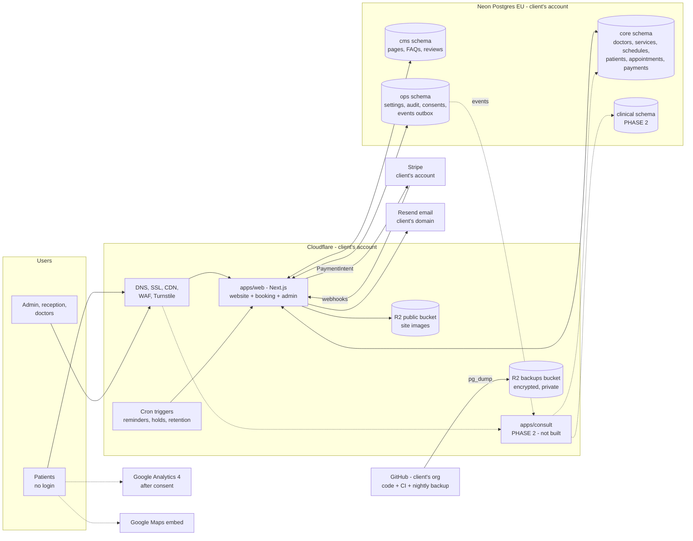

# Software Requirements Specification (SRS)
## Royal Medics Clinic — Phase 1: Website, Online Booking & Payments
### (structured for a future, independent Online Consultation Platform in Phase 2)

| Item | Value |
|---|---|
| Version | 2.0 (replaces v1.0; aligned with client confirmation of 22 Nov 2026) |
| Client | Dr Khalid Siddig — Royal Medics Clinic, Dublin, Ireland |
| Current site | https://www.royalclinicmedics.ie/ (single landing page, to be replaced) |
| Scope of this build | **Phase 1 only** (Section 3). Phase 2 is designed for, not built (Section 5) |
| Audience | Developer and Claude Code (implementation agent) |

---

## 0. Instructions for Claude Code (read first)

1. Build **Phase 1 only**. Do not build video consultation, clinical notes, patient records, certificates, referral letters or a patient document portal. Those belong to Phase 2.
2. But **structure everything** so Phase 2 can be added as a separate app in the same monorepo without rewriting Phase 1 (Section 5 and 6). The extension points listed in Section 5.3 are mandatory.
3. Follow the tech stack exactly (Section 6.3). If a requirement is impossible as written, stop and explain.
4. Anything marked `[TBD]` comes from the client later. Put a placeholder in seed data or settings, list it in `docs/TBD.md`, and continue. Never hard-code clinic details, prices, hours or text in components.
5. TypeScript strict. Zod validation and an authorization check on every server action and route.
6. Time zone **Europe/Dublin** for all scheduling; store UTC. Currency **EUR**, stored as integer cents.
7. Never commit secrets. Provide `.env.example`.
8. The client must be able to run, own and hand the system to another developer. Write clear docs (Section 14).

---

## 1. Introduction

### 1.1 Purpose
This document specifies the requirements for a new clinic website with online booking and payments (Phase 1), and the architectural rules that allow an independent online consultation platform to be added later (Phase 2).

### 1.2 Client's stated priorities
1. Launch a **reliable, professional and affordable** website as soon as possible.
2. The clinic keeps **ownership and control** of the domain, hosting, code, design and all data.
3. Staff can **update services, prices, doctors' schedules and content themselves**.
4. **All recurring costs are identified in advance.**
5. Phase 1 must allow the Phase 2 consultation platform to be **integrated later without rebuilding the website**.

### 1.3 Definitions
| Term | Meaning |
|---|---|
| Patient | Person booking an appointment (no login in Phase 1) |
| Staff | Clinic users who log in to the admin dashboard |
| Appointment | One booked slot: one patient, one service, one doctor, one mode |
| Mode | `IN_CLINIC` in Phase 1. `VIDEO` and `PHONE` exist in the data model but are disabled until Phase 2 |
| Slot | A bookable start time computed from availability rules |
| Hold | A temporary reservation of a slot during checkout (10 minutes) |
| Manage link | A signed link in emails that lets a patient cancel or reschedule without logging in |
| Socrates | The clinic's existing practice management system (Socrates Cloud). **No integration in Phase 1 or Phase 2** |
| IMC | Irish Medical Council |
| GMS / medical card | Irish public medical card scheme |

---

## 2. Stakeholders and user roles (Phase 1)

| Role | Who | Can do |
|---|---|---|
| Visitor / patient | Public, no login | View the site, book, pay online or choose pay at clinic, cancel or reschedule via manage link, send an enquiry |
| Admin | Dr Khalid / clinic owner | Everything: appointments, services and prices, doctors and schedules, holidays, walk-ins, content, settings, staff accounts, exports, refunds, audit log |
| Receptionist | Clinic staff | Appointments, walk-ins, calendar, schedules, enquiries, content. No staff management, settings or exports |
| Doctor | Each approved doctor | View own schedule and appointments, own patients' booking details and questionnaire answers, block own time |

Patient accounts and doctor clinical access are **Phase 2**. In Phase 1, patients never log in.

---

## 3. Phase 1 scope (as confirmed by the client)

| # | Client requirement | Covered by |
|---|---|---|
| 1 | Professional, mobile-friendly website with Home, About Doctor, Services, Service Details, Prices, FAQs, Contact | WEB-01 to WEB-08 |
| 2 | Sticky Book Now button and click-to-call | WEB-00 |
| 3 | Online booking calendar showing available appointments only | BK-01 to BK-23 |
| 4 | Patient registration details and a basic pre-consultation health questionnaire | BK-05, BK-40 to BK-42 |
| 5 | Stripe payments (cards, Apple Pay, Google Pay) with a pay-at-clinic option | PAY-01 to PAY-09 |
| 6 | Automatic email confirmations, reminders, cancellation and rescheduling links | BK-30 to BK-33, N-01 to N-09 |
| 7 | Admin dashboard: appointments, services, prices, doctor availability, working hours, holidays, walk-ins | AD-01 to AD-14 |
| 8 | Contact form, Google Maps and Google reviews | WEB-08, WEB-17 |
| 9 | GDPR privacy policy, terms, cookie consent, patient data security | Section 10 |
| 10 | Basic SEO, Google Analytics, mobile optimisation | WEB-13 to WEB-15 |
| — | Ownership, admin access, handover, data export, cost transparency | Section 12, 13 |
| — | Structure ready for an independent consultation platform | Section 5, 6 |

### 3.1 Out of scope for Phase 1
- Video or phone consultations, clinical notes, patient records, medical certificates, referral letters, prescriptions, patient document access (all **Phase 2**)
- Patient login or patient portal (**Phase 2**)
- SMS reminders (optional add-on; email only in Phase 1)
- Gift vouchers, blog, waiting list (**Phase 3**)
- Any integration with Socrates Cloud
- Online shop, insurance claims, native mobile apps

---

## 4. Functional requirements: Phase 1

### 4.1 Public website

All pages are mobile-first and share a header (logo, navigation, Book Now button), a footer (address, opening hours, phone, email, IMC number, legal links, social links) and the emergency notice.

| ID | Page / feature | Requirements |
|---|---|---|
| WEB-00 | **Sticky actions** | Sticky header with "Book now" on all pages. On mobile, a fixed bottom bar with **Call** (`tel:` link) and **Book now**. Phone number from settings |
| WEB-01 | **Home** `/` | Hero (headline, short intro, Book now and Call buttons); featured services (from database); "How it works" in 3 steps (Choose a service → Pick a time → See the doctor); opening hours; why choose us; Google reviews block (WEB-17); map; final call-to-action |
| WEB-02 | **About the doctor** `/about` | One section per active doctor: photo, name, title, qualifications, IMC number, languages, bio. Clinic photos and values |
| WEB-03 | **Services** `/services` | Service cards grouped by category: name, short description, price, duration, Book button |
| WEB-04 | **Service details** `/services/[slug]` | Description, who it's for, what's included, price, duration, preparation notes, FAQs for that service, Book button that preselects the service. Own SEO title and description |
| WEB-05 | **Prices** `/prices` | Price table generated from the services in the database, grouped by category. Payment options, cancellation and refund policy, medical card note |
| WEB-06 | **FAQs** `/faqs` | Accordion grouped by category, managed in admin. FAQPage structured data |
| WEB-07 | **Booking** `/book` | Booking wizard (Section 4.2) |
| WEB-08 | **Contact** `/contact` | Address, Eircode, phone, email, optional WhatsApp link, opening hours, embedded Google Map, contact form (name, email, phone, message, consent checkbox). Spam protection with Cloudflare Turnstile and a honeypot. Submissions saved and emailed to the clinic, with an auto-reply to the sender |
| WEB-09 | **Legal pages** `/privacy`, `/terms`, `/cookies`, `/cancellation-policy` | Editable in admin, versioned |
| WEB-10 | **Manage booking** `/booking/[ref]?token=` | Shows booking details with Cancel and Reschedule buttons (Section 4.3) |
| WEB-11 | **404 and error pages** | Friendly, with links to Home, Book and the phone number |
| WEB-12 | **Emergency notice** | Footer and booking flow: "This service is not for emergencies. In an emergency call 112 or 999." |
| WEB-13 | **Cookie consent** | Banner with Accept all, Reject all and Customise (necessary, analytics). Google Analytics loads only after consent. Choice stored for 12 months and changeable from the footer |
| WEB-14 | **SEO** | Per-page title and description, Open Graph images, `sitemap.xml`, `robots.txt`, canonical URLs, structured data (`MedicalClinic`, `Physician`, `FAQPage`, `BreadcrumbList`), local SEO for Dublin, Google Search Console verification |
| WEB-15 | **Performance and mobile** | Lighthouse mobile: Performance ≥ 90, Accessibility ≥ 95, SEO ≥ 95, Best Practices ≥ 95. Optimised images. Works on 360 px wide screens |
| WEB-16 | **Analytics** | Google Analytics 4 with consent mode. Events: `begin_booking`, `select_slot`, `begin_checkout`, `booking_confirmed`, `click_to_call`, `contact_submit`. No patient data in events |
| WEB-17 | **Google reviews** | Admin enters selected reviews (author, rating, text, date) and the clinic's Google review link; site shows them with a "See all reviews on Google" button. Optional later upgrade: live reviews via Google Places API (key in settings). Content must respect Medical Council advertising guidance (no claims about clinical outcomes) |

**Initial services (seed data; names, prices and durations `[TBD]` by client, all editable in admin):** GP consultation; Same-day appointment; Children's consultation; Health screening / check-up; Chronic disease review; Vaccinations; Minor procedure; Medical forms and certificates (in clinic).

### 4.2 Booking engine

#### Booking wizard (patient side)

| Step | ID | Requirements |
|---|---|---|
| 1 | BK-01 **Service** | List active, bookable services with price and duration. Deep link `/book?service=<slug>` skips this step. (Mode selection is hidden in Phase 1 because only `IN_CLINIC` is enabled; the code supports modes so Phase 2 can switch them on) |
| 2 | BK-02 **Doctor** | Shown only if more than one active doctor offers the service: choose a doctor or "First available" |
| 3 | BK-03 **Date and time** | Calendar of the next N days (`settings.bookingWindowDays`, default 30) showing only days with free slots; time list grouped Morning / Afternoon / Evening; "Next available" shortcut; all times in Europe/Dublin |
| 4 | BK-04 **Hold** | When a time is chosen, the server places a 10-minute hold. A countdown is shown. If the hold expires the patient is asked to pick again |
| 5 | BK-05 **Patient details** | Booking for: myself / my child / someone else. First name, last name, date of birth, email (with confirm), mobile (Irish default +353), address and Eircode (optional), medical card yes/no, reason for visit (max 500 characters). Parent/guardian name if booking for a child |
| 6 | BK-06 **Health questionnaire** | Basic questions for every booking plus any service-specific questions (BK-40) |
| 7 | BK-07 **Consents** | Required: Terms, Privacy Policy (consent to process health information for the appointment), Cancellation policy. Optional: marketing emails. Store consent type, document version, time and IP |
| 8 | BK-08 **Payment** | Summary (service, doctor, date, time, patient, price). Options: **Pay now** (card, Apple Pay, Google Pay via Stripe) or **Pay at clinic** (only if the service allows it). Optional discount code field |
| 9 | BK-09 **Confirmation** | Booking reference (e.g. `RMC-7F3K2Q`), details, clinic address with map link, Add to calendar (.ics, Google, Outlook), what to bring. Confirmation email sent |

#### Slot rules
- **BK-10** Slots are computed on the server from: each doctor's weekly working hours (several ranges per day), date overrides (extra hours or closed), clinic holidays, blocked times, existing appointments, active holds, service duration, buffer after the appointment, and the slot interval (`settings.slotIntervalMinutes`, default 15).
- **BK-11** Minimum notice: no slot earlier than now + `settings.minNoticeMinutes` (default 60). A service can override this (for example same-day appointments at 15).
- **BK-12** Maximum advance: `settings.bookingWindowDays`.
- **BK-13** A slot is free only if the whole interval (start to end plus buffer) overlaps no active appointment, hold or block for that doctor.
- **BK-14** Daylight saving time handled correctly (tested on the March and October change dates).
- **BK-15** Irish public holidays for the current and next year are pre-loaded and editable.

#### No double bookings
- **BK-20** Holds are stored in `slot_holds` with an expiry.
- **BK-21** A Postgres **exclusion constraint** (`btree_gist`) on `doctor_id` + time range prevents overlapping active holds and overlapping active appointments. Inserts happen in a transaction. On conflict the patient sees: "Sorry, that time was just taken. Please choose another."
- **BK-22** Expired holds are ignored and cleaned up by a scheduled job every 5 minutes.
- **BK-23** When Stripe confirms payment the hold becomes a `CONFIRMED` appointment. If the slot was lost in the meantime, the payment is refunded automatically and the patient is emailed a rebooking link.

#### Statuses
```
Appointment: PENDING_PAYMENT → CONFIRMED → CHECKED_IN → COMPLETED
                             ↘ CANCELLED_BY_PATIENT | CANCELLED_BY_CLINIC | NO_SHOW
Payment:     UNPAID | PAID | PARTIALLY_REFUNDED | REFUNDED | FAILED
Pay-at-clinic bookings go straight to CONFIRMED with payment UNPAID; staff mark them PAID at the clinic.
```

### 4.3 Cancel and reschedule (no login)
- **BK-30** Every confirmation and reminder email contains a **manage link** with a signed token tied to that one appointment, valid until the appointment starts.
- **BK-31** Free cancellation or reschedule up to `settings.cancellationWindowHours` before the start (default 24 `[TBD]`). Online payments are refunded automatically. Inside the window the patient sees the policy and is asked to call the clinic; staff can override.
- **BK-32** Maximum reschedules per booking: `settings.maxReschedules` (default 2).
- **BK-33** If the clinic cancels, the patient is always refunded in full and emailed a rebooking link.

### 4.4 Questionnaire
- **BK-40** Basic questionnaire for every booking: current symptoms or reason (text), known allergies (yes/no + details), current medications (text), relevant conditions (diabetes, heart disease, asthma, pregnancy, other), smoker (yes/no), anything else the doctor should know.
- **BK-41** Admin can add extra questions per service. Types: short text, long text, yes/no, single choice, multiple choice, date, number. Each has a label, required flag and help text.
- **BK-42** Answers are stored with the appointment and shown to staff and the assigned doctor. The questionnaire is **not a medical record**; Phase 2 will import it into the consultation record (Section 5.3).

### 4.5 Payments
| ID | Requirement |
|---|---|
| PAY-01 | Stripe in EUR with Payment Element: cards, Apple Pay, Google Pay (and Link). 3-D Secure handled by Stripe |
| PAY-02 | The amount is always calculated on the server from the database. Metadata on the PaymentIntent: booking reference and hold ID |
| PAY-03 | Webhook `/api/webhooks/stripe` with signature check, handling `payment_intent.succeeded`, `payment_intent.payment_failed`, `charge.refunded`. Webhooks are **idempotent** (processed event IDs stored) |
| PAY-04 | **Pay at clinic**: allowed per service (`payAtClinicAllowed`). Staff mark it paid in admin with the method (card terminal, cash, other) |
| PAY-05 | Full or partial refunds from admin with a reason; patient emailed |
| PAY-06 | Discount codes: percent or fixed amount, validity dates, usage limit, optional service restriction |
| PAY-07 | Receipts: Stripe receipt email, plus a downloadable PDF receipt generated on demand from the manage link and admin (clinic details, receipt number, service, date, amount). VAT wording `[TBD — confirm with accountant]` |
| PAY-08 | No card data is ever stored or handled by our servers |
| PAY-09 | Medical card patients: setting `gmsPolicy` = charge normally / free for eligible services / ask patient to call. Services can be marked GMS-eligible |

### 4.6 Notifications (email)
All templates are editable in admin, with variables such as `{{firstName}}`, `{{service}}`, `{{doctor}}`, `{{date}}`, `{{time}}`, `{{ref}}`, `{{manageLink}}`, `{{clinicPhone}}`, `{{clinicAddress}}`. Emails never contain questionnaire answers or other health details.

| ID | Trigger | Recipient |
|---|---|---|
| N-01 | Booking confirmed (with .ics file and manage link) | Patient |
| N-02 | New booking alert | Clinic inbox, assigned doctor |
| N-03 | Reminder 24 hours before (timing editable) | Patient |
| N-04 | Reminder 2 hours before (optional, editable) | Patient |
| N-05 | Rescheduled | Patient, clinic |
| N-06 | Cancelled (by patient or clinic) with refund details | Patient, clinic |
| N-07 | Payment failed or hold expired | Patient |
| N-08 | Refund issued | Patient |
| N-09 | Contact form received / auto-reply | Clinic / sender |
| N-10 | Staff invite, password reset, sign-in code | Staff |
| N-11 | Daily schedule at 07:00 (optional) | Each doctor |

Scheduled jobs (secured cron endpoints): reminders every 5 minutes (each reminder sent once only), hold cleanup every 5 minutes, data retention clean-up daily, database backup nightly.

### 4.7 Admin dashboard `/admin`

Responsive (works on a tablet at reception). Sidebar navigation, search by patient name, email, phone or booking reference.

| ID | Module | Requirements |
|---|---|---|
| AD-01 | **Dashboard** | Today's appointments as a timeline, counts (today, this week, new in last 24 h), payments today and this month, unpaid pay-at-clinic bookings, new enquiries |
| AD-02 | **Calendar** | Day, week and month views; per doctor or all doctors; drag and drop to reschedule (checks conflicts, emails the patient); click an empty time to add a booking or block time |
| AD-03 | **Appointments** | Table with filters (date, doctor, service, status, payment), sorting, paging. Actions: view, check in, complete, no-show, cancel (with refund choice), reschedule, resend confirmation, mark paid, send payment link. CSV export |
| AD-04 | **Appointment details** | Patient details, questionnaire answers, consents, payment history, refunds, internal staff note (non-clinical), change history |
| AD-05 | **Walk-in and phone bookings** | Create a booking for a new or existing patient in any slot (warning if outside normal hours), mark as walk-in or phone booking, choose: pay at clinic, send Stripe payment link by email, or free |
| AD-06 | **Patients (contacts)** | List and search of people who booked; contact details, booking history, merge duplicates. (Not a medical record) |
| AD-07 | **Services and prices** | Add, edit, hide, reorder: name, URL slug, category, short and full description, price, duration, buffer, doctors who provide it, pay at clinic allowed, GMS eligible, minimum notice override, extra questions, FAQs, featured, SEO fields, image. Changes appear on the website immediately |
| AD-08 | **Doctors** | Add or deactivate doctors (name, title, photo, bio, qualifications, IMC number, languages, services). A doctor can optionally have a staff login |
| AD-09 | **Schedules and working hours** | Weekly hours per doctor (several ranges per day), date overrides, blocked times (one-off or repeating), clinic holidays, clinic opening hours shown on the website |
| AD-10 | **Content** | Edit Home sections, About, legal pages, FAQs, Google reviews, opening hours text, announcement banner (text, dates), contact details, social links, SEO fields. Rich text editor with image upload |
| AD-11 | **Enquiries** | Contact form messages with status (New, Replied, Closed), reply by email from admin, notes |
| AD-12 | **Settings** | Clinic details, booking rules (slot interval, minimum notice, booking window, cancellation window, maximum reschedules, hold length), GMS policy, email templates, reminder timing, integrations status with "send test" buttons (Stripe, email, analytics, maps) |
| AD-13 | **Staff and security** | Invite staff by email with role, deactivate, reset two-factor login. Audit log viewer (who did what, when) |
| AD-14 | **Data export** | Admin only: export patients, appointments, payments, enquiries and consents as CSV, or a full encrypted database backup download. Every export is recorded in the audit log |

---

## 5. Phase 2 readiness: independent online consultation platform

### 5.1 What the client wants later (not built now)
An **independent online consultation platform**, separate from Socrates Cloud, where approved doctors can: log in securely, run video consultations, write clinical notes, keep patient records, issue medical certificates and referral letters, and give patients secure access to their documents.

### 5.2 Architectural decision
- Phase 1 and Phase 2 are **two apps in one monorepo** that share packages (database, authentication, design system, booking logic):
  - `apps/web` — Phase 1 website, booking and admin (`www.royalclinicmedics.ie`)
  - `apps/consult` — Phase 2 consultation platform (`consult.royalclinicmedics.ie`), **added later**
- One Postgres database (Neon) with **separate schemas**:
  - `core` — doctors, services, schedules, patients (contact identity), appointments, payments (Phase 1)
  - `cms` — website content (Phase 1)
  - `ops` — settings, audit log, notifications, consents (Phase 1)
  - `clinical` — notes, records, certificates, referrals, documents (**Phase 2 only**, with stricter access rules and separate encryption keys)
- Phase 2 can therefore reuse the same patients, doctors and appointments without copying data, while clinical data stays isolated.
- If the client later prefers full separation, `clinical` can move to its own database because Phase 1 code never queries it.

### 5.3 Mandatory extension points in Phase 1
| ID | Extension point | Why |
|---|---|---|
| EXT-01 | `appointments.mode` enum already contains `IN_CLINIC`, `VIDEO`, `PHONE`; modes are enabled per service via `services.modes` and a global feature flag `settings.features.onlineConsultations = false` | Phase 2 switches online booking on without changing the booking engine |
| EXT-02 | `appointments.consultation_id` (nullable) and `appointments.external_ref` (nullable) | Link to the Phase 2 consultation record |
| EXT-03 | **Event outbox** table `ops.domain_events` written in the same transaction as changes: `appointment.confirmed`, `appointment.rescheduled`, `appointment.cancelled`, `appointment.checked_in`, `patient.updated`, `payment.succeeded`, `payment.refunded` | Phase 2 (or any future system) subscribes to these events instead of reading tables directly |
| EXT-04 | Internal API in `packages/core` (TypeScript functions, not page code): `getAvailability`, `createHold`, `confirmAppointment`, `cancelAppointment`, `rescheduleAppointment`, `findOrCreatePatient` | Phase 2 books follow-ups through the same rules |
| EXT-05 | Auth with **roles and permissions** (`can(user, action, resource)`), designed to add roles `PATIENT` and doctor clinical permissions later; single sign-on across subdomains via shared auth cookie domain `.royalclinicmedics.ie` | Doctors use one login for both apps |
| EXT-06 | `core.patients` table holds identity and contact only; a stable `patient_id` (UUID) is used everywhere | Phase 2 attaches clinical records to the same patient |
| EXT-07 | Questionnaire answers stored as structured JSON with a versioned schema | Phase 2 imports them into the consultation record |
| EXT-08 | Video provider interface stub `packages/core/video/provider.ts` (interface only, no implementation) | Phase 2 plugs in Daily.co or another provider |
| EXT-09 | Design system in `packages/ui` (colours, fonts, components) | Phase 2 looks like the same brand |
| EXT-10 | Storage helper `packages/core/storage` with private and public buckets defined (only the public one used in Phase 1) | Phase 2 stores clinical documents privately |

---

## 6. Architecture

### 6.1 System diagram (Phase 1, with Phase 2 placeholders dashed)



### 6.2 Monorepo structure

```
/apps
  /web                      # Phase 1: Next.js app (public site, /book, /booking/[ref], /admin, /api)
    /app
      /(site)               # public pages
      /book                 # booking wizard
      /booking/[ref]        # manage booking (signed link)
      /admin                # admin dashboard
      /api                  # webhooks/stripe, cron/*, contact, ics, receipts
    /components
  /consult                  # Phase 2 placeholder: README only, no code
/packages
  /db                       # Drizzle schema (core, cms, ops; clinical reserved), migrations, seed
  /core                     # business logic: booking (slots, holds, rules), payments, notifications,
                            # patients, events outbox, storage, video interface (stub), permissions
  /auth                     # Auth.js config, roles, can(), 2FA
  /ui                       # design tokens + shadcn/ui components shared by both apps
  /emails                   # React Email templates
  /config                   # eslint, tsconfig, tailwind presets
/docs                       # PLAN, DECISIONS, TBD, RUNBOOK, HANDOVER, phase reports
/scripts                    # seed, backup, restore, export
/.github/workflows          # CI, nightly backup
```

Rule: `apps/*` contain only pages, routes and UI. **All business rules live in `packages/core`**, so the Phase 2 app reuses them.

### 6.3 Technology stack

| Layer | Choice | Reason |
|---|---|---|
| Language / framework | TypeScript strict, **Next.js (App Router)** | One codebase for site, booking and admin; fast, SEO-friendly |
| Monorepo | pnpm workspaces + Turborepo | Lets Phase 2 be added as a second app |
| UI | Tailwind CSS + shadcn/ui, lucide icons | Accessible, easy to restyle |
| Forms | react-hook-form + Zod | Same validation on browser and server |
| Database | **Neon Postgres** (EU region) + Drizzle ORM | Free tier to start; standard Postgres, easy to export or move |
| Auth (staff) | Auth.js with email + password and TOTP two-factor | Admin security |
| Payments | **Stripe** Payment Element + webhooks | Cards, Apple Pay, Google Pay |
| Email | **Resend** (sending from the clinic's domain) + React Email | Reliable transactional email |
| Hosting | **Cloudflare Workers** via `@opennextjs/cloudflare` | Free tier allows commercial use; global CDN; SSL |
| Files | Cloudflare R2 (public bucket for site images; private bucket for backups) | Free tier 10 GB, no egress fees |
| Spam protection | Cloudflare Turnstile | Free, privacy-friendly |
| Scheduled jobs | Cloudflare Cron Triggers calling secured `/api/cron/*` | Reminders, cleanup |
| Backups | GitHub Actions nightly `pg_dump`, encrypted, stored in R2, 30-day retention | Free, restorable |
| Analytics | Google Analytics 4 with consent mode, Search Console | Client requirement |
| Maps | Google Maps embed (no API key needed) | Free |
| Testing | Vitest (unit), Playwright (end-to-end, mobile viewport) | |
| Error monitoring | Sentry free tier (optional) | |

Do not use Vercel's free Hobby plan (non-commercial use only). Fallback hosting if needed: a small EU VPS with Docker.

### 6.4 Key flows
1. **Online booking:** patient picks a service → `GET /api/slots` → picks a time → `POST /api/bookings/hold` (exclusion constraint) → enters details, questionnaire and consents → `POST /api/bookings/checkout` creates a Stripe PaymentIntent → pays → Stripe webhook → appointment CONFIRMED, event `appointment.confirmed` written to outbox → confirmation email.
2. **Pay at clinic:** same flow, but checkout confirms immediately with payment UNPAID; staff mark it paid on the day.
3. **Cancel / reschedule:** manage link → token verified → policy checked → appointment updated → refund via Stripe if due → event written → emails sent.
4. **Walk-in:** staff create the booking in admin through the same `packages/core` functions, so all rules and conflict checks apply.
5. **Reminders:** cron every 5 minutes → finds appointments due a reminder → sends once (recorded in `ops.notifications_sent`).

### 6.5 Environments
| Environment | Purpose | Data |
|---|---|---|
| Local | Development | Neon dev branch or Docker Postgres, Stripe test mode |
| Staging | Client review before launch (`staging.royalclinicmedics.ie`, password-protected) | Neon branch, Stripe test mode |
| Production | Live site | Production database, Stripe live mode |

---

## 7. Data model (Phase 1)

All tables: `id uuid` primary key, `created_at`, `updated_at` (timestamptz). Money in integer cents. Times stored in UTC.

```
-- core schema
doctors            id, display_name, title, bio, photo_url, qualifications, imc_number, languages[],
                   user_id? (staff login), is_active, sort_order
services           id, slug, name, category, short_description, description, price_cents, duration_min,
                   buffer_min, modes mode[] default {IN_CLINIC}, pay_at_clinic_allowed, gms_eligible,
                   min_notice_override_min?, featured, active, sort_order, seo_title, seo_description, image_url
service_doctors    service_id, doctor_id
service_faqs       id, service_id, question, answer, sort_order
service_questions  id, service_id, label, type, required, options jsonb?, help_text, sort_order
availability_rules id, doctor_id, weekday, start_time, end_time, modes mode[], valid_from?, valid_to?
availability_overrides id, doctor_id, date, start_time?, end_time?, is_closed, note
clinic_holidays    id, date, name
time_blocks        id, doctor_id, start_at, end_at, reason, recurrence_rule?
patients           id, first_name, last_name, dob, email, phone, address_line1?, address_line2?, city?,
                   eircode?, medical_card bool, guardian_name?, marketing_opt_in, merged_into_id?, deleted_at?
slot_holds         id, doctor_id, service_id, mode, start_at, end_at, expires_at, status
                   EXCLUDE USING gist (doctor_id WITH =, tstzrange(start_at,end_at) WITH &&) WHERE status='ACTIVE'
appointments       id, booking_ref, patient_id, doctor_id, service_id, mode, start_at, end_at, status,
                   payment_status, payment_method_choice (ONLINE|AT_CLINIC|FREE), price_cents,
                   discount_cents, total_cents, reason, questionnaire jsonb, questionnaire_version,
                   source (ONLINE|WALK_IN|PHONE|STAFF), staff_note?, checked_in_at?, completed_at?,
                   cancelled_at?, cancel_reason?, cancelled_by?, rescheduled_from_id?, reschedule_count,
                   manage_token_hash, consultation_id? (EXT-02), external_ref? (EXT-02)
                   EXCLUDE USING gist (doctor_id WITH =, tstzrange(start_at,end_at) WITH &&)
                     WHERE status IN ('PENDING_PAYMENT','CONFIRMED','CHECKED_IN')
payments           id, appointment_id, provider (STRIPE|CLINIC), stripe_payment_intent_id?, amount_cents,
                   status, method (CARD|APPLE_PAY|GOOGLE_PAY|CASH|TERMINAL|OTHER), receipt_number, paid_at
refunds            id, payment_id, stripe_refund_id?, amount_cents, reason, created_by
discount_codes     id, code, type, value, valid_from, valid_to, max_uses, used_count, service_ids[]?, active

-- cms schema
pages              id, key (home, about, privacy, terms, cookies, cancellation), title, body jsonb,
                   seo_title, seo_description, version, updated_by
faqs               id, category, question, answer, sort_order, active
reviews            id, author_name, rating, text, review_date, source ('google'), active, sort_order
announcements      id, text, starts_at, ends_at, active
media              id, r2_key, url, alt, width, height

-- ops schema
users              id, email, name, role (ADMIN|RECEPTIONIST|DOCTOR), password_hash, totp_secret_enc,
                   is_active, last_login_at   (+ Auth.js session tables)
settings           key, value jsonb   -- clinic info, booking rules, feature flags, templates, gmsPolicy
consents           id, patient_id, appointment_id?, type, document_version, accepted_at, ip
enquiries          id, name, email, phone?, message, status, notes, replied_at?
notifications_sent id, appointment_id?, type, channel, recipient, sent_at, provider_id, status
                   UNIQUE (appointment_id, type, channel)
stripe_events      id (Stripe event id), type, processed_at
domain_events      id, type, aggregate_type, aggregate_id, payload jsonb, occurred_at, processed_at?  (EXT-03)
audit_logs         id, actor_user_id?, actor_role, action, entity_type, entity_id, changes jsonb
                   (no health data), ip, user_agent, created_at
data_exports       id, requested_by, type, created_at, file_key?

-- clinical schema: RESERVED FOR PHASE 2. Create the empty schema only.
```

---

## 8. API and server actions (Phase 1)

| Method and path | Purpose | Access |
|---|---|---|
| GET `/api/slots?serviceId&doctorId?&from&to` | Available times | Public, rate-limited |
| POST `/api/bookings/hold` | Create a hold | Public, rate-limited |
| POST `/api/bookings/checkout` | Validate details, consents, discount; create PaymentIntent or confirm pay-at-clinic | Public, rate-limited |
| GET `/api/bookings/[ref]` | Booking summary | Signed token |
| POST `/api/bookings/[ref]/cancel` | Cancel by policy | Signed token |
| POST `/api/bookings/[ref]/reschedule` | Reschedule | Signed token |
| GET `/api/bookings/[ref]/ics` | Calendar file | Signed token |
| GET `/api/bookings/[ref]/receipt.pdf` | Receipt | Signed token or staff |
| POST `/api/contact` | Enquiry | Public + Turnstile |
| POST `/api/webhooks/stripe` | Stripe events | Stripe signature |
| POST `/api/cron/[job]` | Scheduled jobs | `CRON_SECRET` |
| GET `/api/health` | Health check | Public |
| Admin | Server Actions under `/admin`, each calling `packages/core` and `can()` | Staff by role |

---

## 9. Non-functional requirements

| ID | Area | Requirement |
|---|---|---|
| NFR-01 | Reliability | Target 99.5% monthly uptime. If booking is unavailable, show the phone number and a friendly message |
| NFR-02 | Performance | Public pages load in under 2 seconds on 4G; slot lookup under 400 ms |
| NFR-03 | Mobile | Designed for phones first; tap targets at least 44 px; one question per screen in the booking wizard on mobile |
| NFR-04 | Accessibility | WCAG 2.1 AA: keyboard use, labels, focus states, contrast |
| NFR-05 | Browsers | Latest two versions of Chrome, Safari (iOS and macOS), Firefox, Edge, Samsung Internet |
| NFR-06 | Capacity | At least 10 doctors and 300 appointments per day without redesign |
| NFR-07 | Maintainability | Business logic covered by unit tests (≥ 70% for `packages/core`); typed database queries; documented code |
| NFR-08 | Localisation | English (Ireland); dates like "Mon 24 Nov 2026, 10:30"; Eircode field; +353 phone default |
| NFR-09 | Backup and recovery | Nightly encrypted backups, 30 days kept; restore tested before launch; data loss at most 24 hours; restore within 4 hours |

---

## 10. Security, privacy and GDPR

### 10.1 Security
- **SEC-01** HTTPS everywhere, HSTS, security headers (Content Security Policy, frame protection, referrer policy).
- **SEC-02** Staff login: password (minimum 12 characters) plus **two-factor authentication** (authenticator app). Session timeout after 30 minutes idle. Login rate limits and lockout.
- **SEC-03** Role-based permissions through one `can()` helper used by every server action and route.
- **SEC-04** Manage links use signed, expiring tokens tied to a single booking. Booking references alone never reveal data.
- **SEC-05** Input validation with Zod everywhere; parameterised queries via Drizzle.
- **SEC-06** Rate limiting and Cloudflare Turnstile on public forms and booking endpoints.
- **SEC-07** Questionnaire answers and medical card details are only visible to staff and the assigned doctor. They are never sent by email, logged, or sent to analytics.
- **SEC-08** Database and backups in the EU, encrypted at rest. Backups additionally encrypted with a key held by the clinic.
- **SEC-09** Audit log of all staff actions (create, update, delete, export, refunds, logins). Kept 6 years.
- **SEC-10** Dependency checks in CI (`npm audit`, Dependabot).
- **SEC-11** Card data never touches our servers (Stripe).

### 10.2 GDPR
- **GDPR-01** Privacy policy, terms, cookie policy and cancellation policy, all editable and versioned. Templates provided; **the clinic must review them** (or have them reviewed) before launch.
- **GDPR-02** Clear consent at booking for processing health information for the purpose of the appointment, recorded with document version and time.
- **GDPR-03** Cookie consent with analytics off by default.
- **GDPR-04** Data subject requests handled by admin: find a person, export their data (CSV/JSON), correct it, or anonymise it where retention rules allow.
- **GDPR-05** Retention settings: enquiries 2 years, abandoned holds 24 hours, cancelled unpaid bookings 1 year, appointments and payments per clinic policy `[TBD — confirm with Dr Khalid / accountant]`, audit log 6 years.
- **GDPR-06** Sub-processors listed in the privacy policy: Cloudflare, Neon, Stripe, Resend, Google (Analytics, Maps), GitHub (code and encrypted backups). The clinic accepts each provider's Data Processing Agreement in its own account.
- **GDPR-07** Personal data breach procedure documented in `docs/RUNBOOK.md`.
- **COMP-01** Doctors' IMC numbers shown. Content follows Medical Council guidance on advertising.

---

## 11. Design guidelines
- Clean, calm, trustworthy medical style. Brand colours from the clinic's logo `[TBD]`; default deep teal `#0F766E` with warm accent `#F59E0B` for booking buttons only.
- Typography: Inter or similar, 16–18 px body text.
- Real photos of the doctor and clinic `[TBD — client to supply]`; no stock photos posing as clinic staff.
- Every page has a booking action reachable in one tap on mobile.
- Staging site reviewed and approved by the client before launch.

---

## 12. Ownership, access and handover (client requirement)

| Item | Requirement |
|---|---|
| Domain | Stays with the clinic's registrar account. DNS moved to the clinic's own Cloudflare account (free) |
| Accounts | Cloudflare, Neon, Stripe, Resend, GitHub organisation, Google Analytics and Search Console are **all created in the clinic's name and email**. The developer is invited as a member and removed on request |
| Admin access | Dr Khalid receives the top-level **Admin** role in the dashboard and owner access in every account above |
| Source code and design | Stored in the clinic's GitHub organisation from day one. On completion and final payment the clinic receives full ownership of the code, design files and documentation |
| Data | All patient and booking data stays in the clinic's database. Admin can export at any time (AD-14); full database backups are stored in the clinic's R2 bucket |
| Self-management | Staff can change services, prices, doctors, schedules, holidays and website content without a developer |
| Handover pack | `README.md` (setup and deploy), `docs/HANDOVER.md` (all accounts, what each does, monthly costs), `docs/RUNBOOK.md` (backup, restore, incidents, breach procedure), admin user guide (PDF and short videos), list of all environment variables (names only, not values) |
| No lock-in | Standard open technologies (Next.js, Postgres). Any developer can take over |

---

## 13. Running costs (to be confirmed with the client before launch)

| Service | What for | Expected cost at launch | When it would cost more |
|---|---|---|---|
| Domain renewal | royalclinicmedics.ie | Existing (≈ €20–30 per year, clinic's registrar) | — |
| Cloudflare (DNS, hosting, R2, Turnstile) | Website hosting, files, backups | €0 (free tier) | Very high traffic, or optional Workers paid plan ≈ $5/month |
| Neon Postgres | Database | €0 (free tier, 1 GB) | Larger data or always-on compute: paid plan, usage-based |
| Stripe | Online payments | No monthly fee; per transaction ≈ 1.5% + €0.25 for standard EU cards (premium and non-EU cards cost more) | — |
| Resend | Emails | €0 (free tier) | Higher email volume: paid plan |
| Google Analytics, Search Console, Maps embed | Analytics and map | €0 | — |
| GitHub | Code, CI, backups | €0 (free organisation) | — |
| Sentry (optional) | Error alerts | €0 (free tier) | — |
| Maintenance plan (developer) | Updates, monitoring, backups check, small changes, support | `[TBD — quote separately]` | — |

Third-party prices must be re-checked on each provider's pricing page before the quote is sent.

---

## 14. Delivery plan and acceptance (Phase 1)

### 14.1 Milestones
| Milestone | Deliverable |
|---|---|
| M1 Setup and design | Accounts created in the clinic's name, monorepo, design system, homepage design approved on staging |
| M2 Website | All public pages with CMS content, SEO, cookie consent, analytics, contact form, map, reviews |
| M3 Booking and payments | Booking wizard, slot engine, holds, Stripe, pay at clinic, emails, manage links, reminders |
| M4 Admin | Dashboard, calendar, appointments, walk-ins, services, doctors, schedules, holidays, content, settings, exports, audit log |
| M5 Testing and launch | Security checks, end-to-end tests, client acceptance on staging, data/content entry, go-live, handover pack |

### 14.2 Acceptance criteria
- [ ] A patient on a phone can book a service, pay by card or Apple/Google Pay (Stripe test, then one live €1 test), and receive a confirmation email with a calendar file and manage link.
- [ ] Pay at clinic works only for services that allow it, and staff can mark the payment as received.
- [ ] Only free times are shown. Two people trying to book the same time at once: only one succeeds.
- [ ] Working hours, holidays, overrides, blocked time, minimum notice and the booking window are respected, including across daylight saving changes.
- [ ] Patient can cancel or reschedule from the email link; refund is automatic outside the cancellation window; the policy is enforced inside it.
- [ ] Reminder emails are sent once at the configured times.
- [ ] Staff can add a walk-in, drag an appointment to a new time (patient notified) and block time.
- [ ] Admin can add or change a service, price, doctor, schedule, holiday, FAQ or page text, and the website updates without a developer.
- [ ] Admin can export patients, appointments and payments to CSV; exports appear in the audit log.
- [ ] Staff login requires two-factor authentication; a receptionist cannot open settings, staff or exports.
- [ ] Questionnaire answers never appear in emails, logs or analytics.
- [ ] Cookie banner blocks Google Analytics until consent; GA receives booking events after consent.
- [ ] Lighthouse mobile thresholds met (WEB-15). Site tested on iPhone Safari and Android Chrome.
- [ ] Nightly backup runs, and a restore to a test database has been done successfully.
- [ ] All accounts are owned by the clinic; handover pack delivered.
- [ ] Phase 2 extension points EXT-01 to EXT-10 exist and are documented in `docs/PHASE-2-READINESS.md`.

---

## 15. Environment variables (`.env.example`)

```
NEXT_PUBLIC_SITE_URL=https://www.royalclinicmedics.ie
APP_TIMEZONE=Europe/Dublin
AUTH_SECRET=
AUTH_COOKIE_DOMAIN=.royalclinicmedics.ie
SIGNED_LINK_SECRET=
CRON_SECRET=
DATA_ENCRYPTION_KEY=

DATABASE_URL=

STRIPE_SECRET_KEY=
STRIPE_WEBHOOK_SECRET=
NEXT_PUBLIC_STRIPE_PUBLISHABLE_KEY=

RESEND_API_KEY=
EMAIL_FROM="Royal Medics Clinic <bookings@royalclinicmedics.ie>"
CLINIC_NOTIFY_EMAIL=

R2_ACCOUNT_ID=
R2_ACCESS_KEY_ID=
R2_SECRET_ACCESS_KEY=
R2_BUCKET_PUBLIC=rmc-site-assets
R2_BUCKET_BACKUPS=rmc-backups
R2_PUBLIC_BASE_URL=

NEXT_PUBLIC_TURNSTILE_SITE_KEY=
TURNSTILE_SECRET_KEY=

NEXT_PUBLIC_GA_ID=
GOOGLE_PLACES_API_KEY=          # optional, for live reviews later
```

---

## 16. Testing
- Unit (Vitest): slot generation (hours, overrides, holidays, blocks, buffers, minimum notice, window, DST), cancellation policy, pricing and discounts, token signing, permissions.
- Integration: hold → Stripe webhook → confirmed appointment; parallel booking race; refund flow; webhook idempotency; outbox events written.
- End-to-end (Playwright, mobile viewport): full booking with Stripe test card `4242 4242 4242 4242`; pay at clinic booking; cancel and reschedule via email link; admin changes a price and it shows on the site; receptionist adds a walk-in.
- Security: access to another booking with a wrong token fails; receptionist blocked from admin-only pages; rate limits work.

---

## 17. Open questions for the client
1. Final services list with prices, durations, and which allow pay at clinic.
2. Number of doctors at launch, their details, photos and working hours.
3. Clinic address, Eircode, phone, email, WhatsApp, opening hours.
4. Cancellation window and refund rules.
5. Medical card patients: how should they book and pay?
6. Logo, brand colours and photos.
7. Who writes the website text (or should it be drafted for review)?
8. Login details for the domain registrar, or someone who can update DNS.
9. Which email should receive booking alerts and enquiries?
10. Record retention period for booking data.
11. Google Business Profile link and which reviews to display.
